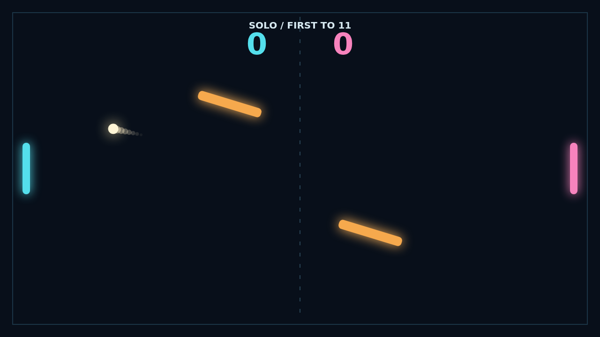

# Carom

A paddle duel where every return can change the whole rally. Read the ball, move into its path, and send it back across a dark arena between two shifting obstacles.

The opening serve gives you a moment to line up. From there, a clean center hit sends the ball straight, while an edge hit carves a sharper angle. Keep your paddle moving at contact and the ball takes on spin, curling after it leaves you.

The two golden bars sway and rotate through the center. A shot that looked safe can bank toward a corner, and a risky return can turn into the winning angle. Track the rebound, not just the ball.

Play Solo against the AI or share a keyboard in Versus. Rally to eleven and win by two; at match point, every curve and bank matters.

